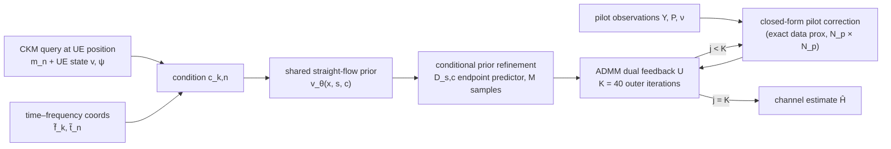

# KAP-Flow: Bridging Pilot Observations and Propagation Knowledge for MIMO Channel Estimation

Official code release for the paper (currently **under review**):

> **KAP-Flow: Bridging Pilot Observations and Propagation Knowledge for MIMO Channel Estimation**
> Ruixuan Li, Shuai Wang, Lingxiang Li, and Zhi Chen
> National Key Laboratory of Wireless Communications, University of Electronic Science and Technology of China (UESTC), Chengdu 611731, China

[](LICENSE)

[](https://github.com/LRXuanxuan/kap-flow-bridging-pilot-observations-and-propagation-knowledge-for-mimo-channel-estimation/actions/workflows/ci.yml)

---

## Abstract

Pilot-limited MIMO channel estimation must infer components beyond the
pilot-observable subspace. We propose KAP-Flow
(Knowledge-Assisted Pilot-Aware Flow Reconstruction), a channel knowledge map
(CKM)-conditioned FlowADMM receiver for mobile users. Location-queried
propagation statistics, user state, and time–frequency coordinates condition a
shared straight-flow prior. A noise-aware complex-domain pilot update,
conditional prior refinement, and dual feedback combine this prior with current
measurements. Across three simulated sites and nine signal-to-noise ratios,
joint conditioning improves aggregate normalized mean-square error (NMSE) by
2.27 dB. With the same conditional prior and one Monte Carlo sample per prior
update, KAP-Flow outperforms PnP-Flow by 4.25 dB. Subspace analysis locates most
conditioning gains in pilot-null directions and most aggregate solver gains in
observable directions. Conditioning remains beneficial in site-transfer tests
using target historical CKMs, while endpoint averaging improves accuracy at
increased inference cost.

## Method at a glance

KAP-Flow couples two mechanisms around a single 4.01-M-parameter flow prior:

| Component | Idea | Code |
|---|---|---|
| **KSC** — knowledge-and-state conditioning | Build the per-observation condition `c_{k,n} = [m_n; q̂(t_n); v; sinψ; cosψ; f̃_k; t̃_n]` from the location-queried CKM descriptor `m_n`, the UE state/velocity, heading, and normalized subcarrier/measurement-time coordinates, and inject it into the conditional velocity field of a shared straight-flow prior | `src/ckmsrf/models/condition.py`, condition block in `src/ckmsrf/config.py` |
| **PPC** — pilot–prior consensus | Alternate an **exact closed-form** noise-aware pilot correction (an `N_p × N_p` inverse, no learned module) with a **conditional prior refinement** through the flow endpoint predictor, and feed their disagreement back through the ADMM dual variable `U` | `src/ckmsrf/sampling_flow.py::sample_flow_admm`, `src/ckmsrf/physics/pnp.py`, `src/ckmsrf/physics/rc.py` |



Key settings from the paper: `K = 40` outer iterations, inverse penalty
`τ = 0.125`, flow-time schedule `s_j = s_min + ((j+1)/K)^γ (s_max − s_min)` with
`(s_min, s_max, γ) = (0, 0.95, 0.25)`, and `M = 1` endpoint sample per iteration
as the default accuracy/cost operating point.

Method equations and the equation → code mapping are in
[`docs/METHOD.md`](docs/METHOD.md); the full paper-term ↔ code-term ↔ legacy-name
mapping is in [`docs/NAMING.md`](docs/NAMING.md).

## Repository structure

```
.
├── src/ckmsrf/                 # core package: models, physics, sampling, losses, data
│   ├── models/                 # U-Net backbone, conditioning, straight-flow / robust flows
│   ├── physics/                # pilot projections, PnP proximal steps, guidance
│   ├── losses/                 # flow-matching / straight-flow / GM / diffusion objectives
│   ├── data/                   # HDF5 shard loader, split index, normalization
│   ├── engine/                 # trainer, checkpoint manager, EMA, reproducibility
│   └── sampling_*.py           # reverse samplers (flow, PnP-ADMM, consistency, classical)
├── src/journal_flow/           # experiment planner / evaluator CLI (checkpoint-guarded)
├── main/                       # paper main method: configs + checkpoints layout
├── baselines/                  # PnP-CM / RC-Flow / SRF comparison baselines
├── configs/                    # experiment, hardware and checkpoint registry YAML/JSON
├── data_generation/            # MATLAB CKM dataset generator (+ HDF5 export)
├── checkpoints/                # checkpoint MANIFEST + downloader (weights live in Releases)
├── tools/                      # checkpoint download/export utilities
├── timing/                     # inference-time benchmark harness
├── tests/                      # historical regression suite (24 modules)
├── scripts/                    # result summary / artifact migration helpers
├── results/                    # reference numbers from the paper (Table I)
├── source_data/                # archived CSVs/JSON behind every number in docs/RESULTS.md
└── docs/
    ├── METHOD.md               # KSC / PPC equations and code mapping
    ├── NAMING.md               # paper ↔ code ↔ legacy-name mapping
    ├── DATA.md                 # data contract, HDF5 layout, dataset generation
    ├── CHECKPOINTS.md          # what each released checkpoint is and where it goes
    └── RESULTS.md              # every number in the paper with its source file
```

## Installation

```bash
git clone https://github.com/LRXuanxuan/kap-flow-bridging-pilot-observations-and-propagation-knowledge-for-mimo-channel-estimation.git
cd kap-flow-bridging-pilot-observations-and-propagation-knowledge-for-mimo-channel-estimation

python -m venv .venv
source .venv/bin/activate          # Windows: .venv\Scripts\activate
pip install -r requirements.txt
# or install the package itself:
pip install -e .
```

The reference environment is Python 3.10+ with PyTorch ≥ 2.1 (the paper numbers
were produced with CUDA GPUs; CPU is enough for the import/smoke checks).
MATLAB is only needed if you want to regenerate the dataset.

## Data

The paper-scale CKM-SRF dataset and the trained weights are **not** committed to
git. Two options:

1. **Generate the dataset** with the self-contained MATLAB generator in
   [`data_generation/`](data_generation/). It uses base MATLAB only (no 5G
   Toolbox) and synthesises geometry-defined three-site mobile mmWave channels
   (fixed scatterers/blockers — *not* 3GPP CDL profiles), exporting plain HDF5
   shards. After generation, run the one-shot preparation script once; it fixes
   the MATLAB scalar-attribute encoding, writes `indices/{split}.json` and
   derives the training-set `normalization.json`:

   ```bash
   export CKMSRF_DATA_ROOT=/path/to/ckm_srf_64x16_h5
   # PowerShell: $env:CKMSRF_DATA_ROOT = "<drive>:\path\to\ckm_srf_64x16_h5"
   python data_generation/python/prepare_kapflow_data.py --data-root "$CKMSRF_DATA_ROOT"
   ```

   See [`data_generation/README.md`](data_generation/README.md) and
   [`docs/DATA.md`](docs/DATA.md).
2. **Use your own channel data** — the HDF5 contract (`H(rx, tx, subcarrier,
   snapshot, sample)`), the split-index format, and the pilot/noise model
   `Y = H P + N` with `ν = ||HP||_F² / (N_r N_p 10^(ξ/10))` are documented in
   [`docs/DATA.md`](docs/DATA.md). The paper setting is `(N_t, N_r, N_p) =
   (64, 16, 19)`, `f_c = 28` GHz, `Δf = 15` kHz, `(N_f, N_s) = (48, 8)`,
   three sites, and `ξ ∈ {−10, −5, …, 30}` dB.

Point the code at your data root:

```bash
export CKMSRF_DATA_ROOT=/path/to/ckm_srf_64x16_h5     # Windows: set CKMSRF_DATA_ROOT=<drive>:\path\to\ckm_srf_64x16_h5
```

## Checkpoints

All 13 network weights and 4 LMMSE statistics are published as **GitHub Release
assets** (426.7 MB in inference format; the `.pt` files are not stored in git).
The evaluation entry point uses the EMA weights, which the release files keep.

```bash
python tools/download_checkpoints.py --tag v1.0-checkpoints --dest checkpoints/
```

The script downloads every asset listed in
[`checkpoints/MANIFEST.json`](checkpoints/MANIFEST.json), verifies its SHA256 and
places it at the path expected by `configs/checkpoints.json`
(`checkpoints/main/...`, `checkpoints/baselines/...`). Use `--dry-run` to inspect
the plan and `--only <id> ...` for a subset. See
[`docs/CHECKPOINTS.md`](docs/CHECKPOINTS.md) for what each file corresponds to in
the paper. Override the location with `CKMSRF_CHECKPOINTS_ROOT` if you keep them
elsewhere.

## Reproducing the paper table

Table I of the paper (NMSE in dB across nine SNRs plus inference time) is
reproduced by the evaluation CLI, which first plans and validates each job
(checkpoint SHA256, CKM-conditioning variant, held-out scenes, normalization)
before running it:

```bash
# 1) inspect the planned jobs for the main method (KAP-Flow)
python run_paper.py kap plan

# 2) validate checkpoints + statistics without running the model
#    (requires an existing data root, see CKMSRF_DATA_ROOT above)
python run.py check --method flowadmm --track standard --conditions ckm no_ckm

# 3) run the evaluation (writes results/ by default; override with KAPFLOW_OUTPUT_ROOT)
python run_paper.py kap evaluate --conditions ckm no_ckm --m 1
```

Baselines are selected with the same launcher:

```bash
python run_paper.py pnpflow evaluate     # PnP-Flow (PF-C / PF-U)
python run_paper.py rcflow  evaluate     # Recursive Flow (RC-C / RC-U)
python run_paper.py srf     evaluate     # RC-S (RC-Flow + SRF)
python run_paper.py pnp-cm  evaluate     # PnP-CM
python run_paper.py ls      evaluate     # LS
python run_paper.py lmmse   evaluate     # LMMSE (needs the released statistics)
```

The reference numbers are in [`results/table1.md`](results/table1.md); the
archived CSVs/JSON behind every number in [`docs/RESULTS.md`](docs/RESULTS.md)
are in [`source_data/`](source_data/).

The **timing column** of Table I comes from the separate benchmark harness
(paper protocol: two runs averaged on two RTX 5090 GPUs, FP32, batch size 16):

```bash
python run_paper.py timing --samples-per-scene 16 --warmup 1 --repeats 1
```

> **Note on the robustness track.** The condition-corruption / robust-prior
> configs (`configs/experiments/ckm_straight_flow_robust.yaml`,
> `main/configs/robustness/`, `main/run_robustness.sh`) ship with the repo for
> completeness, but the paper release does **not** include the `robust_ckm` /
> `robust_no_ckm` weights. `--track robustness` therefore plans and validates
> jobs but has no released checkpoint to evaluate.

## Training

Training uses the same configs that produced the released weights:

```bash
# conditional (CKM) prior for the main method, standard track
python run_paper.py kap train --conditions ckm

# unconditional prior
python run_paper.py kap train --conditions no_ckm

# three-fold (leave-one-site-out) transfer models
python run.py train --method flowadmm --track threefold --folds 1 2 3
```

Baseline priors are trained with `--method pnpflow|rcflow|srf|pnp-cm`; the
LMMSE statistics come from `python run.py fit-stats --method flowadmm`.
Check `configs/hardware/*.yaml` for the GPU memory profiles.

## Citation

If you find this code useful, please cite:

```bibtex
@misc{li2026kapflow,
  title  = {{KAP-Flow}: Bridging Pilot Observations and Propagation Knowledge for {MIMO} Channel Estimation},
  author = {Li, Ruixuan and Wang, Shuai and Li, Lingxiang and Chen, Zhi},
  year   = {2026},
  note   = {Under review}
}
```

A [CITATION.cff](CITATION.cff) file is included for GitHub's citation widget; the
venue entry will be updated once the paper is accepted.

## License and paper copyright

The code is released under the [MIT License](LICENSE). The paper is currently
under review; this repository does **not** redistribute the paper PDF. A link to
the preprint/final version will be added here once available.

## Contact

Please open a GitHub issue for questions about the code, or contact
[@LRXuanxuan](https://github.com/LRXuanxuan).
